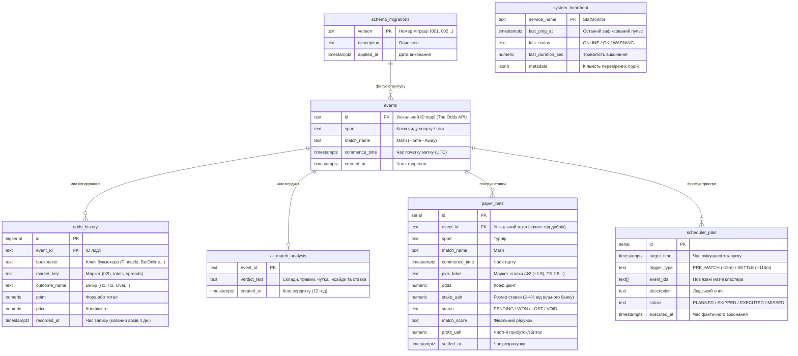

# Візуальна архітектура системи StatMonitor

> **Проєкт**: StatMonitor — інтелектуальна система спортивного моніторингу прогрузів, віртуального трейдингу (Paper Trading), спостережливості (Web Dashboard) та предиктивної AI-аналітики.  
> **Версія**: 2.6 (Еволюція SDD: Telegram Interactive Bot + Smart Rate-Limiter + Dynamic Scheduler + Web Dashboard + 45 Unit Tests)  
> **Оновлено**: 16.11.2026

---

## 1. Загальна схема системи (End-to-End System Architecture)

```mermaid
flowchart TD
    classDef ext fill:#1e293b,stroke:#475569,color:#f8fafc,stroke-width:1px;
    classDef gw fill:#1e3a8a,stroke:#3b82f6,color:#dbeafe,stroke-width:2px;
    classDef core fill:#064e3b,stroke:#10b981,color:#d1fae5,stroke-width:2px;
    classDef pkg fill:#14532d,stroke:#16a34a,color:#dcfce7,stroke-width:1.5px;
    classDef data fill:#701a75,stroke:#d946ef,color:#fae8ff,stroke-width:2px;
    classDef ai fill:#7c2d12,stroke:#f97316,color:#ffedd5,stroke-width:2px;
    classDef notify fill:#14532d,stroke:#22c55e,color:#dcfce7,stroke-width:2px;
    classDef ui fill:#312e81,stroke:#6366f1,color:#e0e7ff,stroke-width:2px;
    classDef test fill:#334155,stroke:#94a3b8,color:#f1f5f9,stroke-width:1px,stroke-dasharray: 3 3;

    subgraph Triggers["🌐 1. Рівень тригерів і планувальника"]
        CronJob["Cron-job.org / Webhook<br>Точний розклад по секундах"]:::ext
        GHFallbackCron["GitHub Actions Fallback Cron<br>schedule: 15,45 * * * *"]:::ext
        ManualAdmin["Admin / CLI<br>python trigger_dispatch.py"]:::ext
        DashboardTrigger["Web Dashboard Button<br>⚡ Запустити моніторинг"]:::ui
        CFWorker["Cloudflare Worker<br>(deploy/cloudflare_webhook.js)<br>Захист ?secret=***"]:::gw
    end

    subgraph GitHubInfra["⚙️ 2. Інфраструктура виконання"]
        GHAPI["GitHub REST API<br>/workflows/scheduler.yml/dispatches"]:::gw
        GHRunner["GitHub Actions Runner (Ubuntu)<br>python -u main.py"]:::core
    end

    subgraph Ingestion["📡 3. Збір даних (Data Ingestion)"]
        OddsAPI["The Odds API v4<br>14 футбольних ліг, NBA, теніс<br>(API_KEY + RESERVE)"]:::ext
    end

    subgraph CoreEngine["🧠 4. Ядро обробки (StatMonitor Core & Package)"]
        MainPy["main.py (Лаконічний оркестратор)"]:::core
        
        subgraph StatMonitorPkg["📦 statmonitor/ (Модульний пакет)"]
            ModPipeline["pipeline.py<br>Конвеєр перевірки та алертингу"]:::pkg
            ModFetcher["fetcher.py<br>API запити та ротація ключів"]:::pkg
            ModLimiter["limiter.py<br>HOT/WARM/COLD ліги & Eco-режими"]:::pkg
            ModDB["database.py<br>Пул з'єднань та адаптація схеми"]:::pkg
            ModAI["ai.py<br>Gemini клієнт + Search Grounding"]:::pkg
            ModPaper["paper_trading.py<br>Стейкінг, розрахунок результатів"]:::pkg
            ModChart["chart.py<br>Matplotlib тренди в пам'яті"]:::pkg
            ModNotify["notifier.py<br>Telegram HTML delivery & chunking"]:::pkg
            ModBot["bot.py<br>Двосторонній асистент /status /bank /run_now"]:::pkg
            ModConfig["config.py<br>Константи, часовий пояс, ліги"]:::pkg
        end

        Watchdog["sys_watchdog.py<br>Pulse & Missed Checkpoints (Dedup)"]:::core
        SchedEngine["scheduler.py<br>Кластеризація, автофіксація EXECUTED"]:::core
        MigrateRunner["migrate.py<br>Версіоновані міграції БД"]:::core
    end

    subgraph AI["🤖 5. Штучний інтелект (AI Layer)"]
        GeminiAPI["Google Gemini API<br>Failover: 3.5-flash-lite ➔ 2.5-flash ➔ 3.8-flash<br>Google Search Grounding<br>Склади, травми, чутки, інсайди"]:::ai
    end

    subgraph Storage["💾 6. Сховище даних (Supabase PostgreSQL)"]
        DB[("PostgreSQL 15+<br>public schema")]:::data
        T_Migrations["schema_migrations"]:::data
        T_Events["events (індекс на commence_time)"]:::data
        T_Odds["odds_history (індекси за часом та маркетом)"]:::data
        V_Alerts["v_odds_alerts (Optimized Window View)"]:::data
        T_AI["ai_match_analysis"]:::data
        T_Bets["paper_bets (індекс за статусом і часом)"]:::data
        T_Sched["scheduler_plan (дедуплікація точок)"]:::data
        T_Poll["sports_poll_log (облік опитування ліг)"]:::data
        T_Beat["system_heartbeat"]:::data
    end

    subgraph TestSuite["🧪 7. Шар якості та тестування (45 unit-тестів)"]
        TestBot["test_bot.py (12 тестів)<br>Команди /bank /status /bets, RBAC, оновлення"]:::test
        TestLimiter["test_rate_limiter.py (6 тестів)<br>HOT/WARM/COLD, Eco-режими, квоти"]:::test
        TestEval["test_eval_picks.py (17 тестів)<br>format_pick, eval_outcome, extract_short_pick"]:::test
        TestModules["test_modules.py (6 тестів)<br>Ізоляція та цілісність statmonitor/"]:::test
        TestSched["test_scheduler.py<br>Кластеризація, точки, маркування EXECUTED"]:::test
        TestWatch["test_watchdog.py<br>Пульс, затримки, дедуплікація"]:::test
        TestMigrate["test_migrate.py<br>Ідемпотентність SQL-міграцій"]:::test
    end

    subgraph Delivery["📲 8. Рівень сповіщень та користувацького UI"]
        Telegram["Telegram Bot API<br>Канал/Чат користувача"]:::notify
        StreamlitUI["Streamlit Cloud Dashboard<br>(dashboard.py)<br>RBAC: Admin vs Read-Only<br>Графік капіталу Plotly, AI-картки"]:::ui
    end

    %% Потоки тригерів
    CronJob -->|HTTP GET/POST| CFWorker
    GHFallbackCron -->|Scheduled Cron| GHRunner
    ManualAdmin -->|Direct API| GHAPI
    DashboardTrigger -->|HTTP Webhook| CFWorker
    CFWorker -->|POST workflow_dispatch| GHAPI
    GHAPI --> GHRunner
    GHRunner --> MainPy

    %% Оркестрація
    MainPy --> ModPipeline
    MainPy --> MigrateRunner
    MigrateRunner --> T_Migrations
    MigrateRunner --> DB

    %% Конвеєр statmonitor
    ModPipeline --> ModDB
    ModPipeline --> ModFetcher
    ModPipeline --> ModAI
    ModPipeline --> ModPaper
    ModPipeline --> ModChart
    ModPipeline --> ModNotify

    %% Дані
    ModFetcher -->|1. Запит ліній| OddsAPI
    OddsAPI -->|Котирування| ModFetcher
    ModFetcher -->|Збереження подій і коеф.| DB
    DB --> T_Events
    DB --> T_Odds
    T_Odds --> V_Alerts

    %% AI та Paper Trading
    V_Alerts -->|Алерти просідання| ModPipeline
    ModAI -->|Запит контексту + Search Grounding| GeminiAPI
    GeminiAPI -->|Вердикт і коротка ставка| ModAI
    ModAI --> T_AI
    ModPaper --> T_Bets

    %% Планувальник та Watchdog
    ModPipeline --> Watchdog
    Watchdog --> T_Beat
    ModPipeline --> SchedEngine
    SchedEngine --> T_Sched
    SchedEngine -.->|mark_checkpoints_executed| T_Sched

    %% Візуалізація та відправка
    ModChart -->|PNG Графік у пам'яті| ModNotify
    ModNotify -->|Фото та HTML зведення| Telegram
    Watchdog -.->|Watchdog Alert при затримці| Telegram

    %% Дашборд
    DB -.->|Прямий зв'язок (autocommit=True)| StreamlitUI
```

---

## 2. Модель даних (Entity-Relationship Diagram)



---

## 3. Детальний опис рівнів системи

### Рівень 1: Високоточний гібридний запуск (Execution Orchestration)
* **Зовнішній сервіс (Cron-job.org)**: викликає Webhook секунда в секунду за розкладом.
* **Шлюз Cloudflare Worker (`deploy/cloudflare_webhook.js`)**:
  - Перевіряє секрет `?secret=***`.
  - Відправляє `workflow_dispatch` на GitHub API за $\sim 50$ мс.
  - Жодних секретів не зберігається у відкритому вигляді (Cloudflare Encrypted Secrets).
* **Кнопка Web Dashboard**: запуск сканування безпосередньо з інтерфейсу Streamlit в один клік (для користувачів з роллю Admin).
* **Резервний GitHub Actions Cron (`.github/workflows/scheduler.yml`)**:
  - Активовано `schedule: - cron: '15,45 * * * *'` (кожні 30 хв у пікові хвилини) як надійний fallback-захист на випадок збоїв зовнішніх пінгерів.
* **GitHub Actions Runner**: без черг стартує контейнер Ubuntu з Python 3.10+ і запускає `main.py`.

### Рівень 2: Збір та адаптація котирувань (Ingestion Engine)
* **Підтримка 14 цільових турнірів**: АПЛ, Ла Ліга, Серія А, Бундесліга, Ліга 1, УПЛ, Екстракласа, Ліга Чемпіонів, Ліга Європи, Ліга Конференцій, Ліга Націй, НБА, Підсумкові турніри ATP та WTA.
* **Автоматична ротація API ключів (`statmonitor.fetcher`)**: при вичерпанні ліміту або 429 перемикається на `ODDS_API_KEY_RESERVE` (сумарний пул 1000 запитів).
* **Динамічна адаптація колонок (`statmonitor.database`)**: безпечна нормалізація при варіаціях схеми Supabase (`event_id` / `match_id`, `price` / `odds`, `point` / `line`).
* **Ковзний архів**: дані котирувань автоматично очищаються після 4 днів (`INTERVAL '4 days'`).

### Рівень 3: Аналітика, AI та віртуальний банк (Intelligence Layer)
* **Оптимізована детекція прогрузів (`v_odds_alerts`)**: віконні функції `FIRST_VALUE` та `LAST_VALUE` за останні 48 годин для миттєвого розрахунку падіння від першого до останнього котирування в діапазоні $1.40 - 4.00$.
* **Каскадний Gemini AI з Google Search Grounding (`statmonitor.ai`)**:
  - Каскад моделей: `gemini-3.5-flash-lite` $\rightarrow$ `gemini-2.5-flash-lite` $\rightarrow$ `gemini-2.5-flash` $\rightarrow$ `gemini-3.8-flash`.
  - Підключено інструмент `google_search` для пошуку свіжих новин, лазарету, дискваліфікацій та інсайдів у режимі реального часу.
  - Структуровані секції: **Склади та кадрові втрати**, **Форма та тонус**, **Інсайди, чутки та суть прогрузу**, **Оцінка валую**.
  - Функція `extract_short_pick`: нормалізація назви ставки, відсікання кефів (`за 2.10`, `@ 1.95`), балансування дужок.
* **Paper Bank (10 000 грн) (`statmonitor.paper_trading`)**:
  - Автоматичний стейкінг: 4% на коефіцієнти $\le 1.75$, 3% на $\le 2.35$, 2% на високі.
  - Автоматичний розрахунок за фінальними рахунками (`WON`, `LOST`, `VOID`).
  - Щоденний звіт з розрахунком ROI о 08:00 за Києвом.

### Рівень 4: Надійність, Watchdog, міграції та планувальник (Reliability Layer)
* **Модульна архітектура пакету `statmonitor/`**:
  - Чітке розділення обов'язків: `config`, `database`, `notifier`, `fetcher`, `chart`, `ai`, `paper_trading`, `pipeline`.
  - Зворотна сумісність: `main.py` залишається центральною точкою входу.
* **Версіоновані міграції БД (`migrate.py`)**:
  - Каталог `migrations/` (`001_base_schema.sql`, `002_performance_indexes.sql`, `003_v_odds_alerts.sql`).
  - Ідемпотентний раннер з журналом у `schema_migrations`.
  - Цільові B-Tree індекси на `odds_history`, `events`, `paper_bets`.
* **Динамічний планувальник (`scheduler.py`)**:
  - Кластеризація подій ($\Delta \le 25$ хв).
  - Формування контрольних точок за 15 хв до гри (`PRE_MATCH` для фіксації Closing Line) та через 115 хв (`SETTLE` для розрахунку ставок).
  - **Автоматична фіксація виконання (`mark_checkpoints_executed`)**: виконані точки переводяться у статус `EXECUTED` з позначкою часу.
  - **Дедуплікація точок розкладу**: запобігання дублюванню однакових матчів у `scheduler_plan`.
* **Системний пульс (`sys_watchdog.py`)**:
  - Фіксація тривалості циклу в `system_heartbeat`.
  - Автоматичне виявлення затримок черг ($> 25$ хв) з алертом у Telegram.
  - Дедуплікація пропущених точок при формуванні повідомлень для уникнення спаму.
  - Підтримка зовнішнього пінгу (`HEALTHCHECK_URL`).

### Рівень 5: Спостережливість та доставка (Observability & Delivery)
* **Інтерактивний веб-дашборд (`dashboard.py` на Streamlit Cloud)**:
  - **RBAC безпека**: Гостьовий режим (Read-Only) без кнопок керування проти режиму адміністратора (`?key=...` або форма входу).
  - Інтерактивний графік зростання банку Plotly (Paper Bank Balance Growth).
  - Вкладка розкладу та живого пульсу системи.
  - Вкладка карток глибокої AI-аналітики з Markdown-розміткою.
* **Telegram Bot API (`statmonitor.notifier`)**:
  - Графіки Matplotlib у пам'яті (`io.BytesIO`) за київським часом.
  - Автоматичне розбиття великих зведень на блоки $\le 3800$ символів.
  - Захист від помилок форматування HTML з fallback на звичайний текст.
