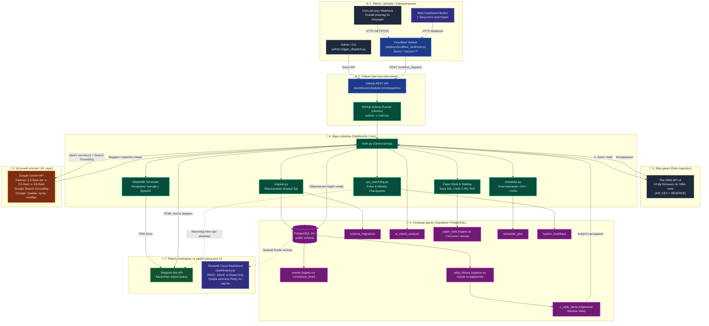
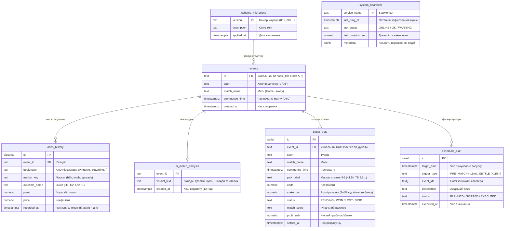

# Візуальна архітектура системи StatMonitor

> **Проєкт**: StatMonitor — інтелектуальна система спортивного моніторингу прогрузів, віртуального трейдингу (Paper Trading), спостережливості (Web Dashboard) та предиктивної AI-аналітики.  
> **Версія**: 2.2 (Еволюція SDD: Dynamic Scheduler + Precision Webhook + Watchdog + Web Dashboard + Migrations Runner)  
> **Оновлено**: 16.11.2026

---

## 1. Загальна схема системи (End-to-End System Architecture)

---

## 2. Модель даних (Entity-Relationship Diagram)

---

## 3. Детальний опис рівнів системи

### Рівень 1: Високоточний гібридний запуск (Execution Orchestration)
* **Зовнішній сервіс (Cron-job.org)**: викликає Webhook секунда в секунду за розкладом.
* **Шлюз Cloudflare Worker (`deploy/cloudflare_webhook.js`)**:
  - Перевіряє секрет `?secret=***`.
  - Відправляє `workflow_dispatch` на GitHub API за $\sim 50$ мс.
  - Жодних секретів не зберігається у відкритому вигляді (Cloudflare Encrypted Secrets).
* **Кнопка Web Dashboard**: запуск сканування безпосередньо з інтерфейсу Streamlit в один клік.
* **GitHub Actions Runner**: без черг стартує контейнер Ubuntu з Python 3.10+ і запускає `main.py`.

### Рівень 2: Збір та адаптація котирувань (Ingestion Engine)
* **Підтримка 14 цільових турнірів**: АПЛ, Ла Ліга, Серія А, Бундесліга, Ліга 1, УПЛ, Екстракласа, Ліга Чемпіонів, Ліга Європи, Ліга Конференцій, Ліга Націй, НБА, Підсумкові турніри ATP та WTA.
* **Автоматична ротація API ключів**: при вичерпанні ліміту або 429 перемикається на `ODDS_API_KEY_RESERVE` (сумарний пул 1000 запитів).
* **Динамічна адаптація колонок**: безпечна нормалізація при варіаціях схеми Supabase.
* **Ковзний архів**: дані котирувань автоматично очищаються після 4 днів (`INTERVAL '4 days'`).

### Рівень 3: Аналітика, AI та віртуальний банк (Intelligence Layer)
* **Оптимізована детекція прогрузів (`v_odds_alerts`)**: віконні функції `FIRST_VALUE` та `LAST_VALUE` за останні 48 годин для миттєвого розрахунку падіння від першого до останнього котирування в діапазоні $1.40 - 4.00$.
* **Каскадний Gemini AI з Google Search Grounding**:
  - Каскад моделей: `gemini-3.5-flash-lite` $\rightarrow$ `gemini-2.5-flash-lite` $\rightarrow$ `gemini-2.5-flash` $\rightarrow$ `gemini-3.8-flash`.
  - Підключено інструмент `google_search` для пошуку свіжих новин, лазарету, дискваліфікацій та інсайдів у режимі реального часу.
  - Структуровані секції: **Склади та кадрові втрати**, **Форма та тонус**, **Інсайди, чутки та суть прогрузу**, **Оцінка валую**.
* **Paper Bank (10 000 грн)**:
  - Автоматичний стейкінг: 4% на коефіцієнти $\le 1.75$, 3% на $\le 2.35$, 2% на високі.
  - Автоматичний розрахунок за фінальними рахунками (`WON`, `LOST`, `VOID`).
  - Щоденний звіт з розрахунком ROI о 08:00 за Києвом.

### Рівень 4: Надійність, Watchdog, міграції та планувальник (Reliability Layer)
* **Версіоновані міграції БД (`migrate.py`)**:
  - Каталог `migrations/` (`001_base_schema.sql`, `002_performance_indexes.sql`, `003_v_odds_alerts.sql`).
  - Ідемпотентний раннер з журналом у `schema_migrations`.
  - Цільові B-Tree індекси на `odds_history`, `events`, `paper_bets`.
* **Динамічний планувальник (`scheduler.py`)**:
  - Кластеризація подій ($\Delta \le 25$ хв).
  - Формування контрольних точок за 15 хв до гри (`PRE_MATCH` для фіксації Closing Line) та через 115 хв (`SETTLE` для розрахунку ставок).
* **Системний пульс (`sys_watchdog.py`)**:
  - Фіксація тривалості циклу в `system_heartbeat`.
  - Автоматичне виявлення затримок черг ($> 25$ хв) з алертом у Telegram.
  - Підтримка зовнішнього пінгу (`HEALTHCHECK_URL`).

### Рівень 5: Спостережливість та доставка (Observability & Delivery)
* **Інтерактивний веб-дашборд (`dashboard.py` на Streamlit Cloud)**:
  - **RBAC безпека**: Гостьовий режим (Read-Only) без кнопок керування проти режиму адміністратора (`?key=...` або форма входу).
  - Інтерактивний графік зростання банку Plotly (Paper Bank Balance Growth).
  - Вкладка розкладу та живого пульсу системи.
  - Вкладка карток глибокої AI-аналітики з Markdown-розміткою.
* **Telegram Bot API**:
  - Графіки Matplotlib у пам'яті (`io.BytesIO`) за київським часом.
  - Автоматичне розбиття великих зведень на блоки $\le 3800$ символів.
  - Захист від помилок форматування HTML з fallback на звичайний текст.
