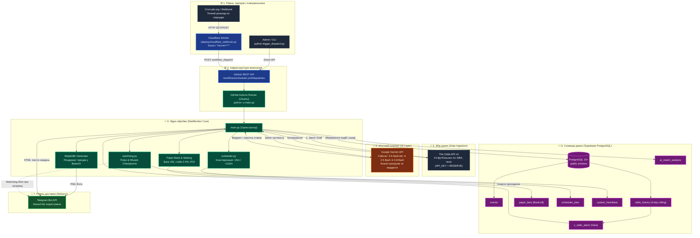
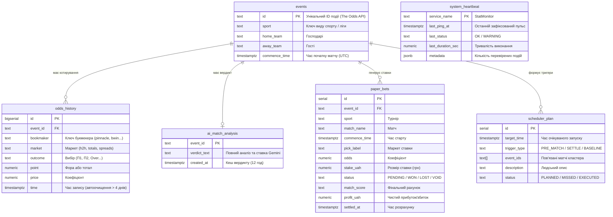

# Візуальна архітектура системи StatMonitor

> **Проєкт**: StatMonitor — інтелектуальна система спортивного моніторингу прогрузів, віртуального трейдингу (Paper Trading) та предиктивної аналітики.  
> **Версія**: 2.0 (Еволюція SDD: Dynamic Scheduler + Precision Webhook + Watchdog)  
> **Оновлено**: 16.11.2026

---

## 1. Загальна схема системи (End-to-End System Architecture)

---

## 2. Модель даних (Entity-Relationship Diagram)

---

## 3. Детальний опис рівнів системи

### Рівень 1: Високоточний гібридний запуск (Execution Orchestration)
* **Зовнішній сервіс (Cron-job.org)**: викликає Webhook секунда в секунду за розкладом.
* **Шлюз Cloudflare Worker (`deploy/cloudflare_webhook.js`)**:
  - Перевіряє токен `?secret=***`.
  - Відправляє `workflow_dispatch` на GitHub API за 50 мс.
  - Жодних секретів не зберігається у відкритому вигляді (використовуються Cloudflare Encrypted Secrets).
* **GitHub Actions Runner**: без черг стартує контейнер Ubuntu з Python 3.10 і запускає `main.py`.

### Рівень 2: Збір та адаптація котирувань (Ingestion Engine)
* **Підтримка 14 цільових турнірів**: АПЛ, Ла Ліга, Серія А, Бундесліга, Ліга 1, УПЛ, Екстракласа, Ліга Чемпіонів, Ліга Європи, Ліга Конференцій, Ліга Націй, НБА, Підсумкові турніри ATP та WTA.
* **Автоматична ротація API ключів**: при вичерпанні ліміту або 429 перемикається на `ODDS_API_KEY_RESERVE`.
* **Динамічна адаптація колонок**: модуль безпечно працює при різних схемах у БД (`event_id`/`match_id`, `price`/`odds`, `point`/`line`).
* **Ковзний архів**: дані котирувань автоматично очищаються після 4 днів (`INTERVAL '4 days'`).

### Рівень 3: Аналітика, AI та віртуальний банк (Intelligence Layer)
* **Детекція аномалій (`v_odds_alerts`)**: відбір матчів із коефіцієнтом від 1.40 до 4.00 та істотним відсотком просідання.
* **Каскадний Gemini AI Failover**: аналіз спортивних прогрузів через `gemini-3.5-flash-lite` $\rightarrow$ `gemini-2.5-flash-lite` $\rightarrow$ `gemini-2.5-flash` $\rightarrow$ `gemini-3.8-flash`. Кешування результатів на 12 годин для економії токенів.
* **Paper Bank (10,000 грн)**:
  - Автоматичний стейкінг: 4% на коефіцієнти $\le 1.75$, 3% на коефіцієнти $\le 2.35$, 2% на високі коефіцієнти.
  - Автоматичний розрахунок за результатами матчів (`WON`, `LOST`, `VOID`).
  - Щоденний звіт з розрахунком ROI о 08:00 за Києвом.

### Рівень 4: Надійність, Watchdog та динамічний розклад (Reliability Layer)
* **Динамічний планувальник (`scheduler.py`)**:
  - Об'єднує події в кластери ($\Delta \le 25$ хв).
  - Формує точки запуску за 15 хв до гри (пікові прогрузи) та через 115 хв (миттєвий розрахунок ставок).
* **Системний пульс (`watchdog.py`)**:
  - Фіксація тривалості циклу в `system_heartbeat`.
  - Автоматичне виявлення затримок черг ($> 25$ хв) з алертом у Telegram.
  - Підтримка зовнішнього пінгу (`HEALTHCHECK_URL`).

### Рівень 5: Доставка результатів (Notification Layer)
* **Графіки Matplotlib**: рендеринг у пам'яті (`io.BytesIO`) без створення сміттєвих файлів на диску, адаптований під часовий пояс `Europe/Kyiv`.
* **Telegram Bot API**:
  - Автоматичне розбиття великих зведень на блоки $\le 3800$ символів.
  - Захист від помилок форматування HTML з fallback на звичайний текст.
  - Обробка rate-limit (HTTP 429) із паузами `retry_after`.
