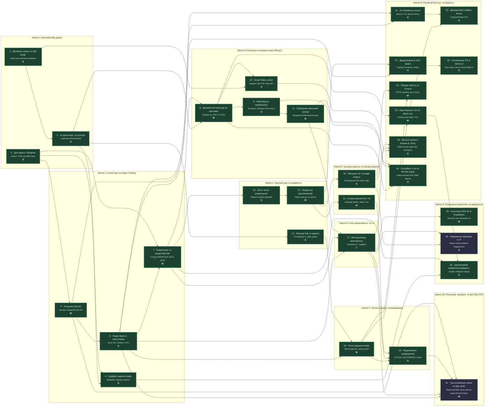

# Візуальна діаграма дорожньої карти (Roadmap diagram)

**29 з 31 кроків реалізовано (29 Shipped, 2 Planned)** · Детальний опис: [roadmap.md](roadmap.md)

> 🟩 **Реалізовано (Shipped)** · 🟧 **У розробці (In Progress)** · 🟪 **Заплановано (Idea)** · ⬜ **Концепт (Fog)**  
> Колонки — це послідовні хвилі виконання (**Execution Waves**). Стрілка показує залежність («потрібен для»).

---

## Короткий опис пунктів українською мовою

| № | Пункт | Розмір | Статус | Короткий опис |
| :---: | :--- | :---: | :---: | :--- |
| **1** | **Детекція схеми та збір коеф.** | `S` | 🟩 Shipped | Автоматично адаптується до різних назв колонок у Supabase (`event_id`/`match_id`, `price`/`odds`) і зберігає котирування. |
| **2** | **Історія коеф. та ротація** | `S` | 🟩 Shipped | Накопичує часові ряди прогрузів та видаляє записи старіші за 4 дні для економії місця. |
| **3** | **Доставка в Telegram** | `S` | 🟩 Shipped | Відправляє сповіщення з розбиттям на блоки до 3800 символів та захистом від блокувань (rate-limit 429). |
| **4** | **Графіки падіння коеф.** | `S` | 🟩 Shipped | Генерує візуальні графіки Matplotlib у пам'яті (`BytesIO`) за київським часом і надсилає як фото. |
| **5** | **AI-аналіз Gemini** | `M` | 🟩 Shipped | Оцінює прогрузи через моделі Gemini з автоперемиканням при лімітах (`3.5-flash-lite` $\rightarrow$ `2.5-flash` $\rightarrow$ `3.8-flash`). |
| **6** | **Paper Bank & автоставки** | `S` | 🟩 Shipped | Веде віртуальний банк 10 000 грн, автоматично ставить 2–4% від банку залежно від коефіцієнта без дублювання. |
| **7** | **Розрахунок та щоденний звіт** | `M` | 🟩 Shipped | Перевіряє фінальні рахунки (`WON`/`LOST`/`VOID`), фіксує прибуток і щодня о 08:00 публікує підсумок з ROI. |
| **8** | **Динамічний розклад за матчами** | `M` | 🟩 Shipped | Аналізує розклад ігор: планує перевірки за 15 хв до старту (пікові прогрузи) та через 115 хв (миттєвий розрахунок). |
| **9** | **Watchdog & Healthcheck** | `S` | 🟩 Shipped | Фіксує пульс системи (`system_heartbeat`), знаходить запізнення GitHub Actions ($> 25$ хв) і надсилає алерт у Telegram. |
| **10** | **Smart Rate-Limiter** | `S` | 🟩 Shipped | Автоматично адаптує частоту опитування ліг (HOT/WARM/COLD) для збереження місячного ліміту запитів The Odds API. |
| **11** | **Гібридний зовнішній тригер** | `M` | 🟩 Shipped | Резервний Webhook (Cron-job / Cloudflare) для гарантованого запуску без затримок у чергах GitHub. |
| **12** | **Юніт-тести розрахунків** | `S` | 🟩 Shipped | Набір із 17 тестів (`test_eval_picks.py`) для маркетів 1X2, фор, тоталів (`eval_outcome`, `format_pick`, `extract_short_pick`). |
| **13** | **Модульна декомпозиція** | `M` | 🟩 Shipped | Розподіл монолітного `main.py` на окремі пакети: `fetcher`, `database`, `ai`, `notifier`, `chart`, `paper_trading`. |
| **14** | **Міграції БД та індекси** | `S` | 🟩 Shipped | Версіонований раннер `migrate.py`, цільові індекси для `odds_history` та оптимізована в'юшка `v_odds_alerts`. |
| **15** | **Інтерактивний бот TG** | `M` | 🟩 Shipped | Двосторонній асистент (`bot_service.py`): команди `/status`, `/bank`, `/bets`, `/today`, `/schedule`, `/run_now` з RBAC. |
| **16** | **Матриця ліг та спорту** | `S` | 🟩 Shipped | Декларативний конфіг `config/leagues.json` для вибору ліг, маркетів та індивідуальних порогів просідання. |
| **17** | **Веб-дашборд моніторингу** | `L` | 🟩 Shipped | Графічний інтерфейс на Streamlit (`dashboard.py`) з історією ставок, прибутком, AI-вердиктами та аналітикою банку. |
| **18** | **Точні медіанні коефіцієнти** | `M` | 🟩 Shipped | Добирання точного `point` з `odds_history`, розрахунок медіани еталонних БК (Pinnacle/Betfair/Unibet) та перерахунок історичних ставок. |
| **19** | **Редагування коефіцієнтів** | `S` | 🟩 Shipped | Зміна коефіцієнта для ставок у статусі `PENDING` через Streamlit Dashboard (адмін-режим), Telegram-бот (`/edit_odds`) та CLI. |
| **20** | **Відстеження CLV & Beat Line** | `M` | 🟩 Shipped | Фіксація Closing Line бенчмарків (Pinnacle/Betfair) перед матчем, розрахунок CLV % та Beat the Line % для доказу математичної переваги (+EV). |
| **21** | **AI Confidence Score & фільтр** | `S` | 🟩 Shipped | Оцінка впевненості 1–10 від Gemini AI та автоматичний фільтр відбору ставок у Paper Bank лише з високим значенням валую ($\ge 7$). |
| **22** | **Динамічний стейкінг Келлі** | `S` | 🟩 Shipped | Дробовий критерій Келлі ($0.25 \times \text{Kelly}$) з межами 1–5% та відображенням % банку в активних ставках UI та TG. |
| **23** | **Обидві заб'ють (BTTS) & цілі тотали** | `M` | 🟩 Shipped | Підтримка ринку Both Teams to Score (Yes/No) у футболі та фільтрація тоталів виключно до стандартних цілих і половинних ліній. |
| **24** | **Аналітика ROI ліг & Drawdown** | `M` | 🟩 Shipped | Сегментація ROI за турнірами на Web Dashboard, розрахунок максимального просідання капіталу (Max Drawdown %), серій (Streaks) та фільтри. |
| **25** | **Керування порогами в UI** | `S` | 🟪 Idea | Інтерфейс адміністратора на дашборді для налаштування порогів чутливості ліг (`min_drop_pct`, діапазонів коеф.) без правок коду. |
| **26** | **Щотижневий графічний дайджест** | `S` | 🟩 Shipped | Автоматичний звіт щонеділі о 22:00 (та команда `/digest`) у Telegram: графік зміни капіталу за тиждень, топ-3 ставки, показник середнього CLV та тижневий ROI. |
| **27** | **Дедуплікація & Anti-Spam** | `S` | 🟩 Shipped | Виключення з пайплайну аналізу та Telegram-сповіщень тих матчів, по яких у `paper_bets` уже зафіксовано активну ставку (`PENDING`), захист від дублювання та спаму. |
| **28** | **Мульти-квота Odds API (5 кл) & Теніс** | `S` | 🟩 Shipped | 5-рівневий пул квот (2500 запитів/міс) з моніторингом у Streamlit та пульсі, динамічне автовиявлення тенісних змагань (ATP/WTA). |
| **29** | **Cloudflare Cron & Фільтр шуму** | `S` | 🟩 Shipped | Секундний запуск Cloudflare Cron (`*/20 * * * *`), фокус PRE_MATCH точок тільки на ставках, нічна тиша (00:00–08:00) та усунення спаму Watchdog. |
| **30** | **Оптимізація TG & Silent AI** | `S` | 🟩 Shipped | Збереження повних AI-вердиктів Gemini у базі даних без перевантаження Telegram, посилання на Guest Web UI та захист від спаму повторними ставками. |
| **31** | **Гра на реальні гроші & Bet Slip OCR** | `M` | 🟪 Idea | Можливість гри на реальні гроші (UAH), введення реального банку, відмічання реальних ставок, завантаження фото купона БК в адмінці/TG та авторозпізнавання через Gemini Vision. |
