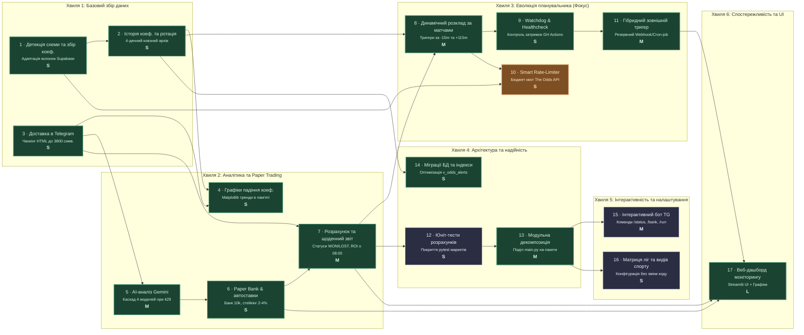

# Візуальна діаграма дорожньої карти (Roadmap diagram)

**13 з 17 кроків реалізовано (Shipped)** · **1 в процесі (In Progress)** · Детальний опис: [roadmap.md](roadmap.md)

> 🟩 **Реалізовано (Shipped)** · 🟧 **У розробці (In Progress)** · 🟪 **Заплановано (Idea)** · ⬜ **Концепт (Fog)**  
> Колонки — це послідовні хвилі виконання (**Execution Waves**). Стрілка показує залежність («потрібен для»).

---

## Короткий опис пунктів українською мовою

| № | Пункт | Розмір | Статус | Короткий опис |
| :---: | :--- | :---: | :---: | :--- |
| **1** | **Детекція схеми та збір коеф.** | `S` | 🟩 Shipped | Автоматично адаптується до різних назв колонок у Supabase (`event_id`/`match_id`, `price`/`odds`) і зберігає котирування. |
| **2** | **Історія коеф. та ротація** | `S` | 🟩 Shipped | Накопичує часові ряди прогрузів та видаляє записи старіші за 4 дні для економії місця. |
| **3** | **Доставка в Telegram** | `S` | 🟩 Shipped | Відправляє сповіщення з розбиттям на блоки до 3800 символів та захистом від блокувань (rate-limit 429). |
| **4** | **Графіки падіння коеф.** | `S` | 🟩 Shipped | Генерує візуальні графіки Matplotlib у пам'яті (`BytesIO`) за київським часом і надсилає як фото. |
| **5** | **AI-аналіз Gemini** | `M` | 🟩 Shipped | Оцінює прогрузи через моделі Gemini з автоперемиканням при лімітах (`3.5-flash-lite` $\rightarrow$ `2.5-flash` $\rightarrow$ `3.8-flash`). |
| **6** | **Paper Bank & автоставки** | `S` | 🟩 Shipped | Веде віртуальний банк 10 000 грн, автоматично ставить 2–4% від банку залежно від коефіцієнта без дублювання. |
| **7** | **Розрахунок та щоденний звіт** | `M` | 🟩 Shipped | Перевіряє фінальні рахунки (`WON`/`LOST`/`VOID`), фіксує прибуток і щодня о 08:00 публікує підсумок з ROI. |
| **8** | **Динамічний розклад за матчами** | `M` | 🟩 Shipped | Аналізує розклад ігор: планує перевірки за 15 хв до старту (пікові прогрузи) та через 115 хв (миттєвий розрахунок). |
| **9** | **Watchdog & Healthcheck** | `S` | 🟩 Shipped | Фіксує пульс системи (`system_heartbeat`), знаходить запізнення GitHub Actions ($> 25$ хв) і надсилає алерт у Telegram. |
| **10** | **Smart Rate-Limiter** | `S` | 🟧 In Progress | Автоматично регулює частоту опитування ліг, щоб не спалити місячний ліміт запитів The Odds API. |
| **11** | **Гібридний зовнішній тригер** | `M` | 🟩 Shipped | Резервний Webhook (Cron-job / Cloudflare) для гарантованого запуску без затримок у чергах GitHub. |
| **12** | **Юніт-тести розрахунків** | `S` | 🟪 Idea | Набір тестів `pytest` для перевірки парсингу маркетів (`format_pick`) та логіки перемог (`eval_outcome`). |
| **13** | **Модульна декомпозиція** | `M` | 🟩 Shipped | Розподіл монолітного `main.py` на окремі пакети: `fetcher`, `database`, `ai`, `notifier`, `chart`, `paper_trading`. |
| **14** | **Міграції БД та індекси** | `S` | 🟩 Shipped | Версіонований раннер `migrate.py`, цільові індекси для `odds_history` та оптимізована в'юшка `v_odds_alerts`. |
| **15** | **Інтерактивний бот TG** | `M` | 🟪 Idea | Підтримка команд у чаті (`/status`, `/bank`, `/run_now`) для ручного перегляду стану та тригеру. |
| **16** | **Матриця ліг та спорту** | `S` | 🟪 Idea | Винесення переліку турнірів і фільтрів у конфіг замість жорсткого кодування в скрипті. |
| **17** | **Веб-дашборд моніторингу** | `L` | 🟩 Shipped | Графічний інтерфейс на Streamlit (`dashboard.py`) з історією ставок, прибутком, AI-вердиктами та аналітикою банку. |
