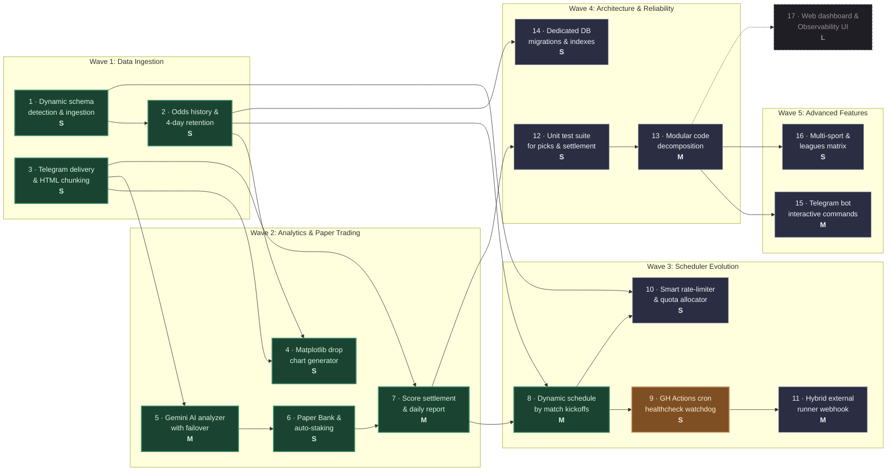

# Roadmap diagram

8 of 17 steps shipped · 1 in progress · source: [roadmap.md](roadmap.md)

🟩 shipped · 🟧 in progress (specified, designed or being built) · 🟪 idea · ⬜ fog: not yet formulated. Columns are the execution waves; steps outside a column are not scheduled yet. An arrow means «needed by».

