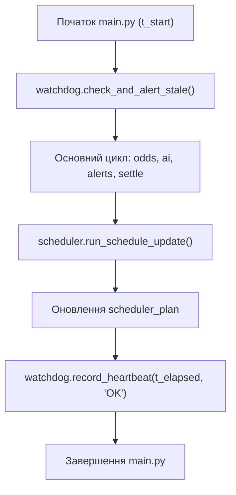

# Технічний план реалізації SPEC-09: Монітор здоров'я (Watchdog)

## 1. Архітектура рішення

Створюється модуль `watchdog.py`:
1. `ensure_heartbeat_table(cur, conn)` — створює `system_heartbeat`.
2. `record_heartbeat(cur, conn, duration_sec, status, metadata)` — оновлює пульс поточного виконання.
3. `detect_missed_checkpoints(cur, conn, now_utc, threshold_minutes=25)` — шукає прострочені `PLANNED` завдання в `scheduler_plan`.
4. `detect_stale_heartbeat(last_ping_at, now_utc, threshold_minutes=150)` — перевіряє, чи не завис моніторинг.
5. `format_watchdog_alert(missed_points, stale_info)` — формує чіткий текст попередження для Telegram.

---

## 2. Інтеграція в робочий процес `main.py`

---

## 3. Точка розширення для зовнішніх сервісів
У `watchdog.py` передбачено функцію `ping_external_watchdog(url=None)`:
Якщо задано змінну середовища `HEALTHCHECK_URL` (наприклад, безкоштовний пінг на [healthchecks.io](https://healthchecks.io)), модуль надсилає HTTP GET `requests.get(HEALTHCHECK_URL, timeout=10)` — якщо GitHub Actions помре повністю, healthchecks.io надішле сповіщення на пошту або в Telegram безкоштовно.
