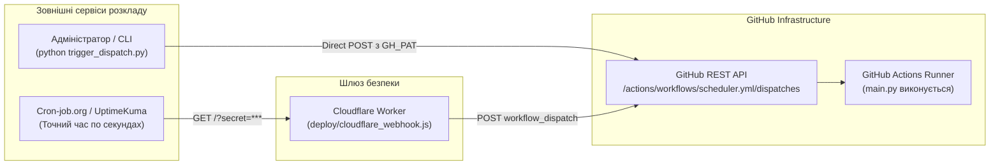

# Технічний план реалізації SPEC-11: Гібридний зовнішній тригер

## 1. Архітектурна схема



---

## 2. Формат запитів GitHub Actions API
* **Endpoint**:
  `https://api.github.com/repos/{OWNER}/{REPO}/actions/workflows/{WORKFLOW_ID}/dispatches`
* **Headers**:
  ```http
  Accept: application/vnd.github+json
  Authorization: Bearer <GITHUB_TOKEN>
  X-GitHub-Api-Version: 2022-11-28
  ```
* **Payload**:
  ```json
  {
    "ref": "main",
    "inputs": {
      "trigger_source": "external_webhook"
    }
  }
  ```
* **Очікувана відповідь**: `HTTP 204 No Content` (успішна постановка в чергу виконання).
